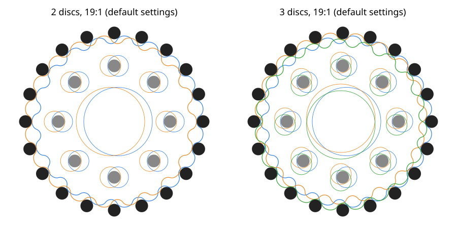

# Robotic Reducers

**Capstan, belt and cycloidal drives for robot joints, generated in Fusion.**

A Fusion add-in that generates complete, printable gearboxes for stepper motors. It adds
three commands under **SOLID > CREATE**:

| Command | Ratio | Best for |
|---|---|---|
| **Cycloidal Drive** | 5:1 – 150:1 in one stage | Compact, high-torque joints. Supports 1, 2 or 3 discs. |
| **Belt Drive** | Usually 2:1 – 5:1 per stage | Simple joints, or a motor mounted away from the joint. GT2 and HTD belts. |
| **Capstan Drive** | Usually 5:1 – 15:1 | Zero-backlash, smooth, back-drivable robot arm joints. |

Each command opens a dialog with a live **Summary** that shows the ratio and key sizes and flags
any problems. **Generate** is disabled while there is an error. Each command remembers the
settings you used last (in `RoboticReducers/settings/`).

## Install
1. Copy the **`RoboticReducers`** folder (the one inside this repo) to
   - macOS: `~/Library/Application Support/Autodesk/Autodesk Fusion 360/API/AddIns/`
   - Windows: `%APPDATA%\Autodesk\Autodesk Fusion 360\API\AddIns\`
2. In Fusion, press **Shift+S** (or go to **Utilities > Add-Ins**). On the **Add-Ins** tab, select *RoboticReducers*, tick
   *Run on Startup*, and click **Run**.
3. If you used an earlier version (*CycloidalDrive* or *FusionReducers*), stop it, untick its *Run on Startup*, and remove
   its folder. Robotic Reducers includes everything they did.

All generators build the motor at a plate whose top face is Z = 0. The motor sits below the plate.

---

## Cycloidal Drive



| Component | Notes |
|---|---|
| Disc 1..n | Each disc is phased to its own eccentric (2 discs: 0/180°, 3 discs: 0/120/240°) and has the bore for its bearing and the output holes. |
| Eccentric Cam | One lobe per disc, with a D-flat bore for the motor shaft. |
| Ring Pins | Separate bodies, for dowel pins or printed pins. Each end sits in a blind seat. |
| Housing | Ring with pin seats plus an optional NEMA 14/17/23 base plate. The bore clears the lobe tips by 0.5 mm all the way round. |
| Top Cover | Ring with blind pin seats that holds the top ends of the ring pins. |
| Output Carrier | Plate with the output pins built in. It stays inside the ring pins. |

- **Ratio = ring pins − 1**, and the output turns the opposite way to the motor.
- **Eccentricity** must be less than the ring radius ÷ the number of pins. A bigger eccentricity gives taller lobes but sharper tips.
- **Profile clearance** shrinks the disc. Use about 0.1 mm for FDM printing.
- **Output pin diameter** is the diameter that touches the disc. If the pins have rollers, use the roller diameter.
- The disc bore is the bearing OD and the cam OD is the bearing ID. The defaults suit a 6704 bearing (20×27×4 mm).
- **2 vs 3 discs:** both cancel the forces in the plane of the discs. 3 discs run smoother and share the load across more lobes. Both leave a small rocking couple because the discs are stacked.

## Belt Drive

| Component | Notes |
|---|---|
| Motor Pulley | Toothed pulley with flanges, a hub, a D-flat bore and M3 set-screw holes. |
| Output Pulley | Toothed pulley with flanges, an axle bore, bolt holes for an arm link, and a spacer underneath. |
| Belt (reference) | Shows where the belt runs. Buy the belt; don't print it. |
| Motor Plate | Slotted NEMA holes for tensioning the belt, plus a bearing seat for the output axle. |

- **Profiles:** GT2 2 mm, GT2 3 mm, HTD 3M and HTD 5M. Set the belt width to match the belt you buy.
- You enter the **closed belt length in teeth**, and the add-in works out the exact centre distance. A
  280 mm GT2 belt has 140 teeth. With the defaults (20T → 60T, 3:1), the centre distance is 99.2 mm.
- **Teeth in mesh:** the summary warns if fewer than 6 teeth on the small pulley are engaged with the belt.
- **Groove clearance:** the grooves are a printable approximation of the real tooth shape. Print a short test pulley first, and increase *Groove clearance*
  if the belt won't seat in the grooves.
- The motor slots give ± *tension travel* (2 mm by default). Pull the motor back until the belt is tight, then tighten the motor screws.
- For more reduction, chain two stages: generate a second drive and put its motor pulley on the first stage's output.

## Capstan Drive

| Component | Notes |
|---|---|
| Motor Drum | Drum with a helical cable groove, a cross-hole in the middle for anchoring the cable, a D-flat bore, and set screws. |
| Output Sector | The joint. It has a rim with lips that guide the cable, a web, a hub with an axle bore and bolt holes, and cable anchors at both ends. |
| Base Plate | Holds the NEMA motor and the bearing for the joint axle. |

- **Ratio** = sector pitch diameter ÷ drum pitch diameter. "Pitch" means measured at the cable's centre.
- **Joint range:** set how far the joint has to turn. The add-in sizes the sector span and the
  number of drum turns from it. With the defaults (8:1, 180°), the drum needs 7 turns and you need about 73 cm of cable.
- **Cable:** if you're not sure which to use, start with **1 mm Dyneema or braided fishing line**. It's easy on printed drums
  and easy to tension. Steel rope is stiffer but wants a drum at least 18× the cable diameter, and the summary warns
  if yours is smaller.
- **Stringing it:**
  1. Put the joint in the middle of its range (the position it's generated in).
  2. Thread the middle of the cable through the drum's cross-hole.
  3. Wind each half of the cable round the drum for half of the turns, in opposite directions, so the two halves
     move apart along the groove.
  4. Run each end to the sector, along the rim, and down the slot at that end. Wrap it 2–3 times round
     the M3 screw.
  5. Pull both ends tight evenly, then tighten the screws to clamp the cable.
- If Fusion can't cut the helical groove, the drum is left smooth and a message tells you so. You can also turn the groove off yourself.

## What's not included
Fasteners, the axle and bearings (they're just seats), a top cover for the belt and capstan drives, and the
bearing between the cycloidal output and its housing.

## Repository layout
```
RoboticReducers/       <- the add-in folder you copy into Fusion
  RoboticReducers.py     entry point, registers the three commands
  fusion_ui.py           shared dialog framework and modelling helpers
  *_command.py           one per drive: parameters, summary and modelling
  *_geometry.py          pure-Python math and validation (no Fusion needed)
tests/                 unit tests
docs/                  images
```

## Tests
```bash
python3 -m unittest discover tests
```
The geometry tests check that:
- every cycloidal disc touches every pin and clears the housing
- belt lengths and centre distances round-trip exactly, and the pulley outlines don't cross themselves
- the capstan cable is tangent to both drums and stays on the rim over the full joint range

`test_commands_stub.py` runs every command's modelling code against a stand-in for Fusion's API, with
every part toggle and motor choice. That catches code errors, but only real Fusion shows the
final geometry.
